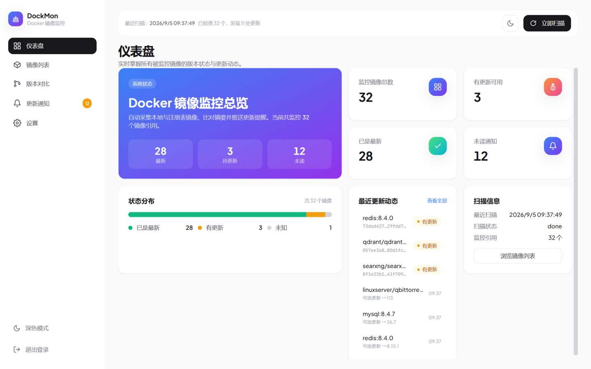
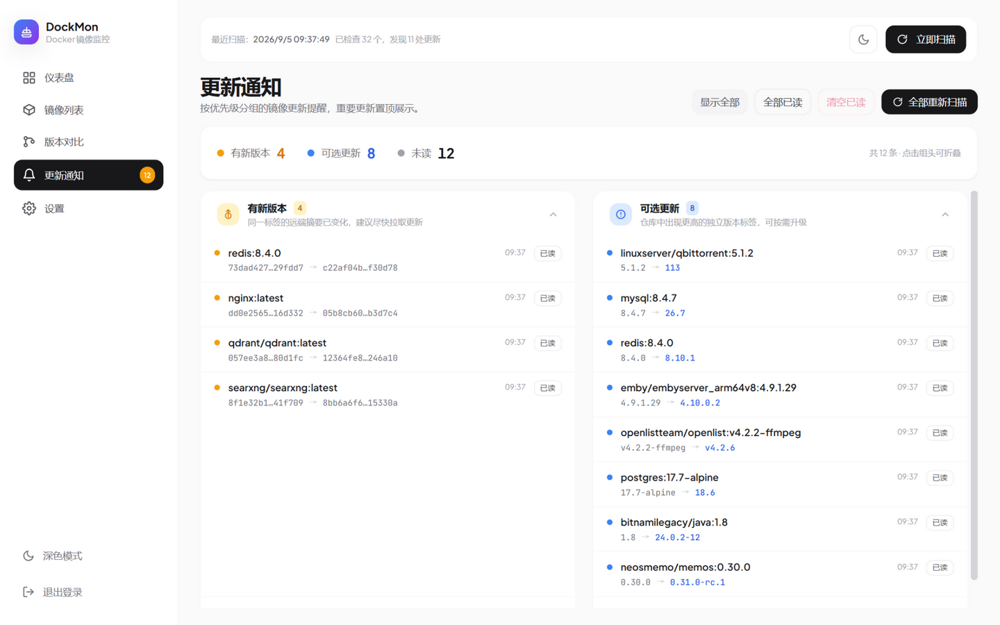
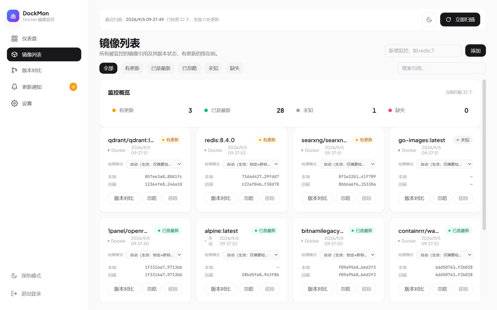
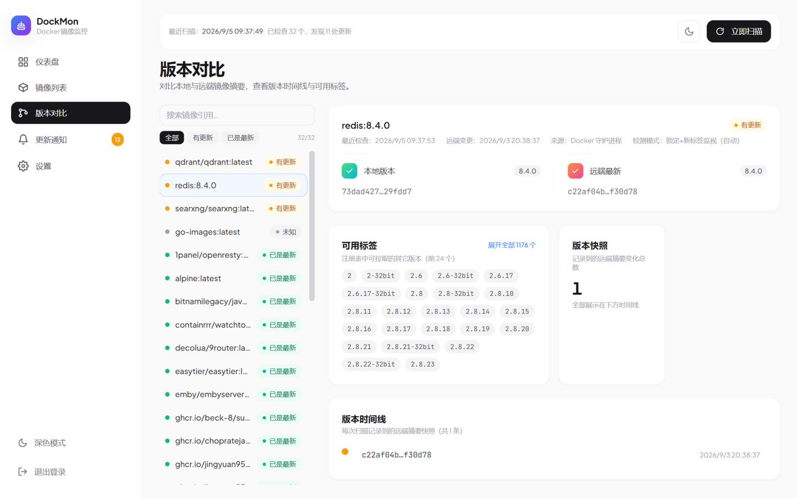
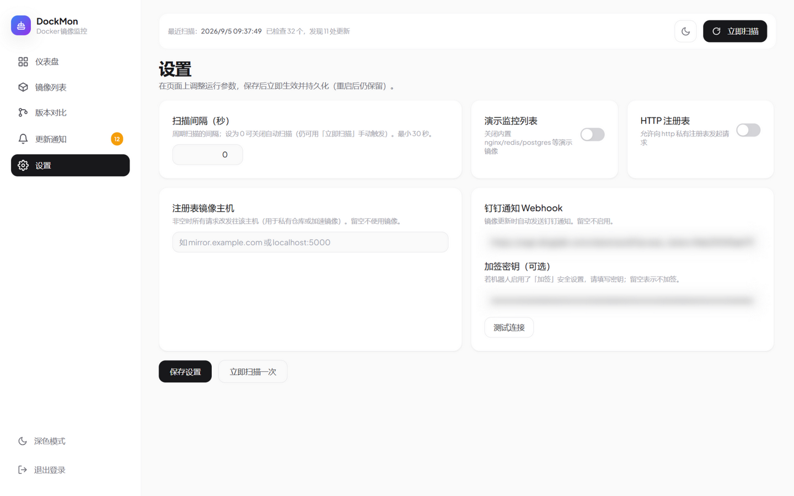
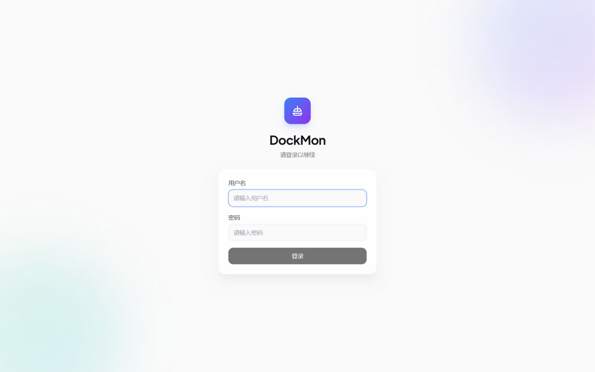

<div align="center">


# vigil

_应用名 Vigil · Docker 镜像监控_

**🐳 Docker 镜像更新监控与通知 —— 单容器、单端口、开箱即用**

[](LICENSE)
[](https://github.com/jingyuan9527/vigil/tags)
[](https://github.com/jingyuan9527/vigil/actions/workflows/build.yml)
[](backend/go.mod)
[](https://github.com/jingyuan9527/vigil/stargazers)


</div>

一个参考 [diun](https://github.com/crazy-max/diun) 与 [wud (What's Up Docker)](https://github.com/fmartinou/whats-up-docker) 的 Docker 镜像更新监控工具：自动采集本机镜像（或手动添加监控项），比对注册表摘要与新版本标签，发现更新第一时间推送提醒（站内 + 多渠道）。

**特性一览**

- 🔍 **两种检测模式自动分配**：浮动标签（`latest` 等）追踪摘要变化；版本号标签（如 `8.4.5`）额外监视仓库的新版本 tag（如锁定 `8.4.5` 而仓库已有 `26`）
- 🔔 **按镜像聚合的通知**：一镜像一条记录，展示当前监控版本与最新版本；同一版本只推送一次，候选版本合并去重排序，支持已读/忽略，避免冗余提醒。支持**多推送渠道**并行（钉钉 / 企业微信 / 飞书 / Telegram / 通用 Webhook）
- 🖥️ **开箱即用的 Web UI**：单容器、单端口（54321）部署，仪表盘 / 镜像列表 / 版本对比 / 通知中心 / 在线设置
- 🔐 **账号认证**：JWT httpOnly Cookie + 登录限流；SQLite 持久化，数据不出本机
- 🧱 **多架构镜像**：GitHub Actions 自动构建 `linux/amd64` 与 `linux/arm64`，x86 服务器与树莓派均可直接拉取

## 界面预览

| 仪表盘 | 更新通知 |
|---|---|
|  |  |

| 镜像列表 | 版本对比 |
|---|---|
|  |  |

---

## 快速开始

> 唯一依赖是一个 Docker 环境（本机、NAS、树莓派均可），唯一端口 **54321**。

### 方式一：GHCR 预构建镜像（推荐）

镜像由 GitHub Actions 自动构建并发布到 GitHub Container Registry，已包含 `linux/amd64` 与 `linux/arm64` 双架构，无需本地编译，Docker 会自动匹配宿主架构。

`docker run` 一键启动：

```bash
docker run -d --name vigil \
  -p 54321:54321 \
  -v /var/run/docker.sock:/var/run/docker.sock \
  -v dockmon-data:/data \
  --restart unless-stopped \
  ghcr.io/jingyuan9527/vigil:latest
```

或使用预置的 compose 文件（仅拉取镜像、不构建）：

```bash
docker compose -f docker-compose.ghcr.yml up -d
```

启动后访问 `http://localhost:54321`：

- 首次使用会引导**初始化管理员账号**；也可用 `ADMIN_USER` / `ADMIN_PASSWORD` 环境变量免交互创建。
- 挂载 `docker.sock` 后会自动监控本机所有带 tag 的镜像；未挂载（或无 Docker 守护进程）时也可通过 `WATCH` 变量或页面「添加监控」监视任意注册表镜像。
- 内置演示监控列表（nginx / redis / postgres 等）**默认关闭**，部署后即是纯净环境；需要演示数据可在设置页开启，或用 `DISABLE_DEFAULT_WATCH=0` 启用。

### 方式二：源码构建

```bash
git clone https://github.com/jingyuan9527/vigil.git
cd vigil
docker compose up -d --build
# 访问 http://localhost:54321
```

### 方式三：本地开发

```bash
# 后端（默认 54321 端口）
cd backend && go run ./cmd/server

# 前端（另开终端，Vite 将 /api 代理到 54321）
cd frontend && npm install && npm run dev
# 访问 http://localhost:5173
```

---

## 工作原理

```
┌──────────────────────────────────────────────────────────┐
│                       Docker 容器                          │
│                                                            │
│   React + Tailwind 静态资源  ──┐                           │
│                                │  54321 (单端口同源)        │
│   Go HTTP Server  ─────────────┤                           │
│     ├─ /api/*    REST 接口      │                           │
│     ├─ /*        前端 SPA        │                           │
│     ├─ scanner   采集+检测+通知   │                           │
│     ├─ registry  注册表摘要比对   │                           │
│     └─ store     SQLite 持久化   │                           │
└───────────────┬────────────────┘                           │
                │ 挂载 /var/run/docker.sock                  │
                ▼                                            │
        Docker 守护进程 / 注册表                               │
```

每个扫描周期（启动时立即执行一次）分三步：

1. **采集**：通过 Docker Engine API 读取本机全部带 tag 镜像及其摘要，合并 `WATCH` / 手动添加的纯远端监控项。
2. **检测**：向注册表（Docker Hub / GHCR / 私有 registry）查询当前 tag 的 manifest 摘要与本地比对；Pin-Watch 模式额外巡检仓库完整 tag 列表。
3. **通知**：当前 tag 摘要变化或仓库出现更高版本 → 合并为该镜像的一条聚合更新记录；同一版本只推送一次，站内 + 所有启用渠道并行推送（钉钉 / 企微 / 飞书 / Telegram / 通用 Webhook），并记录版本时间线。

---

## 检测模式与通知边界

每个镜像有两种检测模式，默认按 tag 自动识别（可在镜像列表手动覆写）：

### Digest-Only（仅校验当前标签摘要）
- 默认分配给浮动标签（`latest` / `nightly` / `dev` / `canary` / `beta`）及其它非版本号 tag。
- 只查当前 tag 的远端摘要是否变化 → 变化时推送一条聚合更新提醒（同一摘要只提醒一次）。
- **常规扫描不拉取仓库全部 tag 列表**（仅在摘要变化、需要展示最新版本时补查一次），也不会单独通知仓库中的其它版本。

### Pin-Watch（锁定版本 + 监视新标签）
- 默认分配给数字版本号 tag（如 `8.4.5`、`v3.9`、`1.2.3-alpine`）。
- 仍对比当前 tag 摘要（用于状态与版本时间线），但**锁定 tag 被仓库覆盖时不发告警**。
- 额外巡检仓库完整 tag 列表，出现**任何新的版本 tag** 都提醒：既包括高于当前锁定 tag 的版本，也包括 `7.4.12-alpine` 这类其它分支/低版本补丁（恢复旧版「可选新版本」语义）。
- 同一镜像当轮发现的多个新 tag 合并为一条「⭐ 镜像出现更新的独立版本」提醒，tag 去重并按版本号降序；同版本别名（`0.31` 与 `0.31.0`）只留一个，预发布后缀（`0.31.0-rc.2`）各自保留。
- 首巡只建立已见标签基线：页面能看到当时已存在的更高版本，但不会为此推送；之后同一 tag 不会重复提醒（含强制扫描）。

### 通知聚合与防抖
- 每个镜像至多一条聚合记录，展示**当前监控版本、最新版本、候选版本、摘要变化**与已读/忽略状态；通知页按镜像聚合展示，不再逐次罗列事件。
- 只有相对「已通知状态」出现**新版本 tag**（含低版本/其它分支）或浮动 tag 的**摘要变化**时才推送一次；同一 tag/摘要的重复扫描（含强制扫描）不会重复提醒。
- 同一次检测周期内发现的多个新版本 tag 合并进同一条通知，去重并排序展示；页面同时保留「候选版本」（可升级）与「可选新版本」（最近提醒的新 tag）两组信息。
- **忽略此版本**：忽略后同版本（含其摘要变化）不再提醒；出现更高版本时自动解除忽略并恢复未读。**取消忽略**转已读。
- **目标达成即自动已读**：本地已用上最新版本，或本地摘要已同步到当前远端 → 聚合记录自动转已读（记录保留，差异消失后不再展示）。
- 页面未读角标统计聚合记录（每镜像只计一次）；推送历史（`notifications` 表）仅作留档，已读历史每次扫描后自动裁剪至最近 500 条。

### 强制扫描（「全部重新扫描」）
语义为**重新检测**：只重新拉取远端状态并刷新聚合记录（用于补齐失败轮次、同步版本信息），**不会对相同版本重复推送**；出现新版本或摘要变化时仍会正常提醒。
- 本地镜像：刷新本地/远端摘要与版本信息。
- 纯远端监控：刷新上次记录的远端基线与候选版本。
- Pin-Watch 镜像：重新巡检仓库 tag 列表，候选集合变化才产生新提醒。
- 被忽略的镜像跳过全部检测，不产生任何通知。

---

## 核心页面

- **仪表盘**：监控总览（已是最新 / 有更新 / 未读）与状态分布、最近更新动态、扫描信息一览。
- **镜像列表**：有更新的排在前；「监控概览」统计卡即状态筛选入口（点击切换、再点取消，零计数自动隐藏），支持搜索与分页；每张卡片可切换检测模式、忽略/恢复、移除，或进入版本对比。
- **版本对比**：本地 vs 远端摘要（存在差异时高亮）、可用标签（按版本号新→旧排序，超长默认折叠）与版本时间线。
- **更新通知**：按优先级分两栏——「有新版本」（摘要变化/可升级）与「可选更新」（新 tag，含其它分支）；按镜像聚合展示「当前监控版本 → 最新版本」、候选版本与最近提醒的「可选新版本」，支持全部/未读/已忽略筛选、单条/全部已读、忽略此版本/取消忽略，以及「全部重新扫描」（重新检测但不重复推送相同版本）。
- **设置**：在线调整扫描间隔、演示列表、http 注册表、注册表镜像与**通知渠道**（多类型增删改、启用/停用、单渠道连通性测试），保存后即时生效并持久化（重启保留）。

| 设置（通知渠道等运行时参数） | 登录（首次访问初始化管理员） |
|---|---|
|  |  |

---

## 配置（环境变量）

| 变量 | 默认值 | 说明 |
|------|--------|------|
| `PORT` | `54321` | 对外服务端口 |
| `DB_PATH` | `/data/monitor.db` | SQLite 数据库路径 |
| `STATIC_DIR` | `./static` | 前端静态资源目录 |
| `DOCKER_HOST` | `unix:///var/run/docker.sock` | Docker 守护进程地址（`unix://` / `tcp://`） |
| `TZ` | `UTC` | 容器时区（如 `Asia/Shanghai`），影响扫描记录与通知中的时间显示 |
| `SCAN_INTERVAL` | `3600` | 周期扫描间隔（秒）；设为 `0` 关闭周期扫描（仍可手动触发），最小 30 |
| `REGISTRY_INSECURE` | `false` | 是否允许 `http` 注册表 |
| `REGISTRY_MIRROR` | 空 | 注册表镜像主机（非空时所有 manifest/tag 请求改发该主机，用于私有仓库/加速） |
| `WATCH` | 空 | 额外监控的镜像引用，逗号分隔（如 `nginx:latest,redis:7`） |
| `DISABLE_DEFAULT_WATCH` | `true` | 内置演示监控列表（nginx / redis / postgres 等）默认关闭；设为 `0`（或 `false`）启用演示数据 |
| `ADMIN_USER` / `ADMIN_PASSWORD` | 空 | 首次部署自动创建管理员（两者需同时设置，密码至少 6 位） |
| `JWT_SECRET` | 空 | JWT 签名密钥；不设置则自动生成并持久化到数据库 |
| `DINGTALK_WEBHOOK` | 空 | 钉钉机器人 Webhook；**仅作为首次启动把钉钉迁移为「通知渠道」的初值**，此后在页面「设置 → 通知渠道」统一管理 |
| `DINGTALK_SECRET` | 空 | 钉钉机器人加签密钥（机器人开启「加签」安全设置时填写），随迁移一并写入渠道 |

> 扫描间隔、演示列表、http 注册表、注册表镜像这四项**也可在页面「设置」中直接修改**，保存后即时生效并持久化到数据库，重启后仍然保留；环境变量仅作为首次启动的初值。通知渠道则由页面「设置 → 通知渠道」独立管理（`DINGTALK_*` 环境变量只做一次性的迁移初值）。

---

## REST API

| 方法 | 路径 | 说明 |
|------|------|------|
| GET | `/api/health` | 健康检查 |
| GET | `/api/auth/check` | 是否需要初始化设置 + 当前是否已认证 |
| POST | `/api/auth/setup` | 首次部署设置管理员账号（成功后写入登录 cookie） |
| POST | `/api/auth/login` | 登录（成功后写入登录 cookie） |
| POST | `/api/auth/logout` | 登出（清除登录 cookie） |
| GET | `/api/stats` | 仪表盘统计 |
| GET | `/api/images?status=` | 镜像列表（可按状态过滤） |
| POST | `/api/images` | 新增手动监控 `{ "reference": "nginx:latest" }` |
| GET | `/api/images/:id` | 镜像详情（含版本时间线、可用 tag） |
| DELETE | `/api/images/:id` | 移除监控 |
| PUT | `/api/images/:id/mode` | 设置检测模式覆写 `{ "mode": "auto" \| "digest-only" \| "pin-watch" }` |
| PUT | `/api/images/:id/ignored` | 忽略 / 恢复提醒 |
| POST | `/api/scan?force=1` | 立即扫描；`force=1` 仅重新检测并刷新聚合记录，不重复推送相同版本 |
| GET | `/api/scans` | 扫描历史 |
| GET | `/api/updates?status=unread` | 按镜像聚合的更新记录（当前/最新版本、候选版本、已读/忽略状态） |
| POST | `/api/updates/:image_id/read` | 标记该镜像更新为已读 |
| POST | `/api/updates/:image_id/ignore` | 忽略当前版本（出现更高版本自动恢复提醒） |
| POST | `/api/updates/:image_id/unignore` | 取消忽略并转已读 |
| POST | `/api/updates/read-all` | 全部聚合记录标记已读 |
| GET | `/api/notifications?unread=1` | 推送历史留档（支持 `cursor` 翻页；页面不再使用） |
| POST | `/api/notifications/:id/read` | 标记单条历史通知已读 |
| POST | `/api/notifications/read-all` | 全部历史通知已读 |
| POST | `/api/notifications/clear-read` | 清空全部已读历史通知（未读不受影响） |
| GET / PUT | `/api/settings` | 读取 / 更新运行时设置（持久化并即时生效） |
| GET | `/api/channels` | 通知渠道列表（含插件式渠道类型） |
| POST | `/api/channels` | 新增通知渠道 `{ "kind", "name", "enabled", "config": {...} }`（kind：`dingtalk` / `wecom` / `feishu` / `telegram` / `webhook`） |
| GET / PUT / DELETE | `/api/channels/:id` | 读取 / 更新 / 删除单条渠道 |
| POST | `/api/channels/:id/test` | 向指定渠道发送测试消息 |
| POST | `/api/dingtalk/test` | 测试钉钉连通性（旧接口保留：可携带 `webhook/secret`，缺省用渠道表中首条启用的钉钉渠道） |

> **认证与安全**：JWT 通过 `httpOnly` cookie（`SameSite=Lax`）下发，前端 JS 不接触令牌，降低 XSS 窃取风险；跨站请求不携带 cookie，天然抵御 CSRF。登录/初始化接口按 IP 限流：连续 5 次失败锁定 15 分钟。
>
> **扫描并发**：同一时刻只允许一次扫描执行（定时、手动、添加镜像并发触发时后到者跳过），重复触发 `/api/scan` 返回 `"result": "scan already running"`。

---

## 多架构镜像与版本

项目通过 GitHub Actions（[`.github/workflows/build.yml`](.github/workflows/build.yml)）自动构建 `linux/amd64` 与 `linux/arm64` 双架构镜像并推送至 GHCR（Buildx 构建：前端与 Go 阶段固定在构建机架构上原生执行、Go 用 `GOARCH` 交叉编译，仅运行镜像按目标架构拉取，避免 QEMU 模拟编译；复用 Actions 缓存；推送至 GHCR 无需额外配置，`GITHUB_TOKEN` 自动授权）：

| 触发 | 产出标签 | 用途 |
|------|----------|------|
| push `v1.2.3` 标签 | `1.2.3`、`1.2`、`1`、`latest` | 稳定版 / 锁定大版本 / 回滚 |
| push 到 `main` | `edge`、`sha-xxxx` | 开发版尝鲜 |
| Pull Request | 不推送，仅构建校验 | — |

流水线分三个 job：质量门禁（`gofmt` / `go vet` / `go test -race`）与镜像构建**并行**执行，构建先把双架构镜像以未打标签的 digest 推入 GHCR，由第三个 job 在门禁与构建双双通过后才创建上表标签——既不串行等待，门禁失败也不会产出可用的 `latest` / `edge`（仅残留一个无标签 digest，不占用任何标签）。`main` 分支与 PR 的前端编译由镜像构建统一承担，不在门禁里重复一遍。

版本号按 [RULES.md](RULES.md) 的语义化版本规则由提交内容自动推导（feat → 次版本，fix → 修订号，破坏性变更 → 主版本）。推荐生产环境锁定大版本，自动获取补丁：

```yaml
image: ghcr.io/jingyuan9527/vigil:1
```

---

## 许可证

本项目采用 **AGPL-3.0 双许可**，详见 [LICENSE](LICENSE)：

- **开源使用（默认）**：依据 [GNU AGPL-3.0](https://www.gnu.org/licenses/agpl-3.0.html) 自由使用、修改与分发；通过网络对外提供本程序或其衍生版本的服务时，需按同一许可证公开对应源代码。
- **商业授权（可选）**：需要闭源集成、OEM 或不满足 AGPL 义务的商业部署，请联系作者（[GitHub Issues](https://github.com/jingyuan9527/vigil/issues)）获取商业许可。

---

## 目录结构

```
.
├── Dockerfile              # 多阶段构建（node 前端 + golang 后端）
├── docker-compose.yml      # 源码构建一键部署
├── docker-compose.ghcr.yml # GHCR 预构建镜像部署
├── backend/                # Go 后端
│   ├── cmd/server/main.go  # 入口：配置、扫描调度、HTTP 服务
│   └── internal/
│       ├── config/         # 环境变量与运行时设置
│       ├── docker/         # Docker Engine API 客户端
│       ├── registry/       # 注册表客户端（manifest 摘要 + 鉴权）
│       ├── store/          # SQLite 存储与 CRUD
│       ├── scanner/        # 扫描编排（采集→检测→通知）
│       ├── notification/   # 多渠道推送
│       ├── auth/           # 认证与限流
│       └── api/            # REST 路由 + 静态资源服务
└── frontend/               # React + Tailwind 前端
    └── src/pages/          # Dashboard / Images / Compare / Notifications / Settings
```

